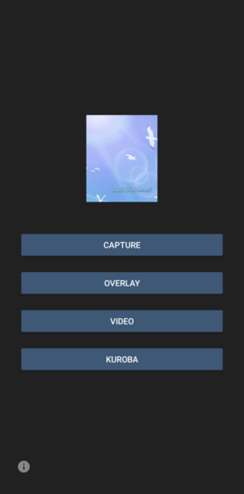
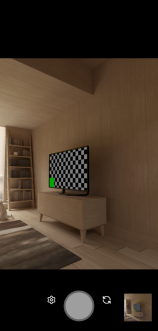
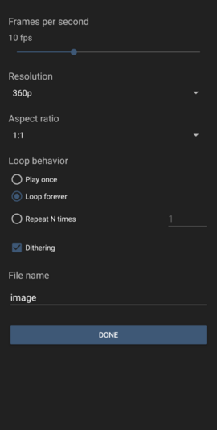
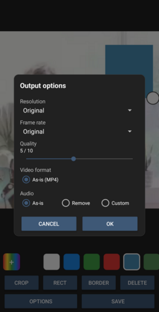
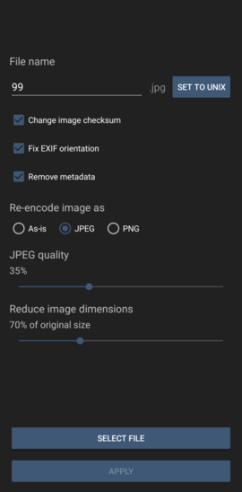
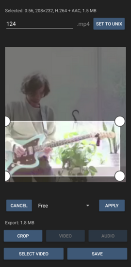

Sunshower is a light image editor that allows you to,

- Take animated GIFs directly from your phone camera. It supports,
    - dither
    - frames per second
    - animation loop count
    - resolution
    - file naming
- Overlay rectangles and box frames on media files.
- Crop media
- Remove and extract audio from videos
- Apply KurobaEx edits to media

| Feature        | Images | GIF | Video |
| -------------- | ------ | --- | ----- |
| Capture        |        | ✅  |       |
| Crop           | ✅     | ✅  | ✅    |
| Overlay shape  | ✅     | ✅  | ✅    |
| Compress       | ✅     | ✅  | ✅    |
| Audio Extract  |        |     | ✅    |

See if its what you're looking for, here are some screenshots.

